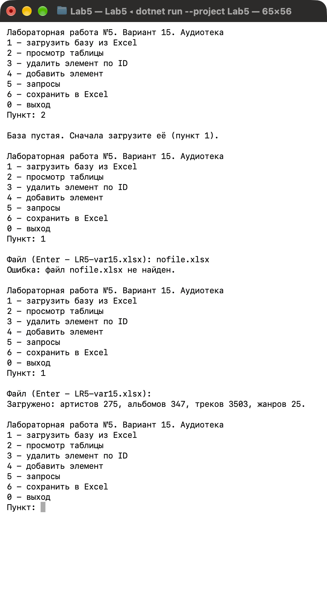
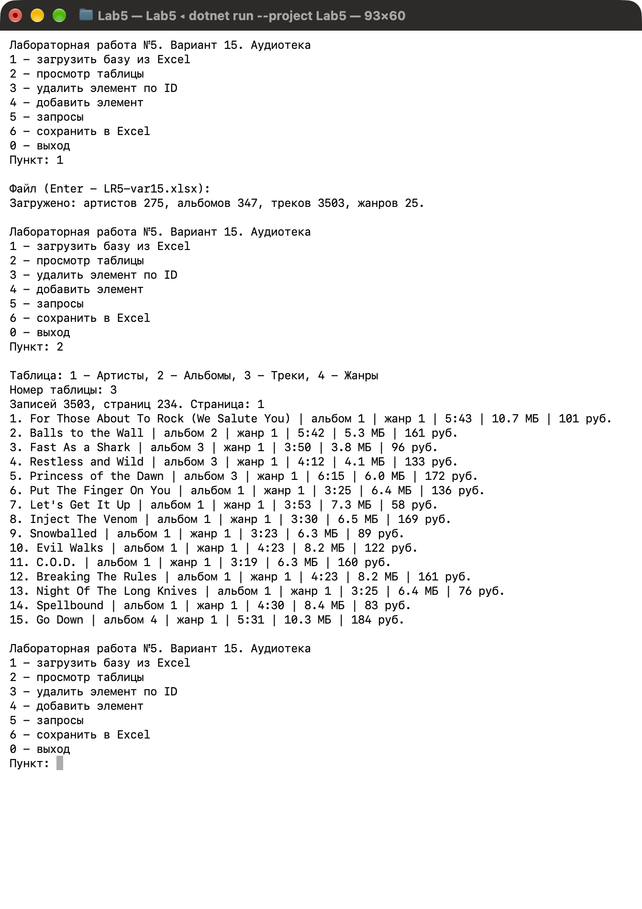
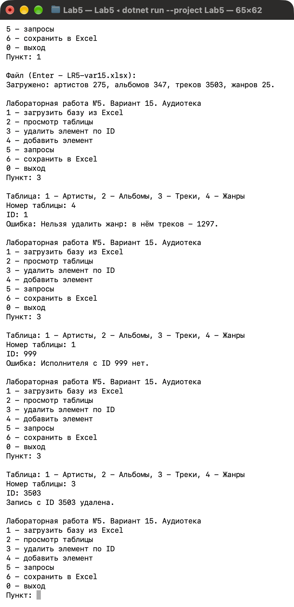
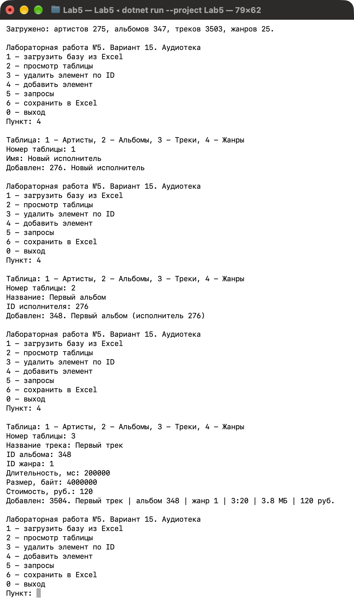
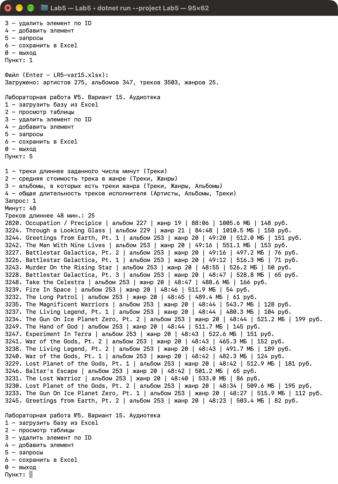
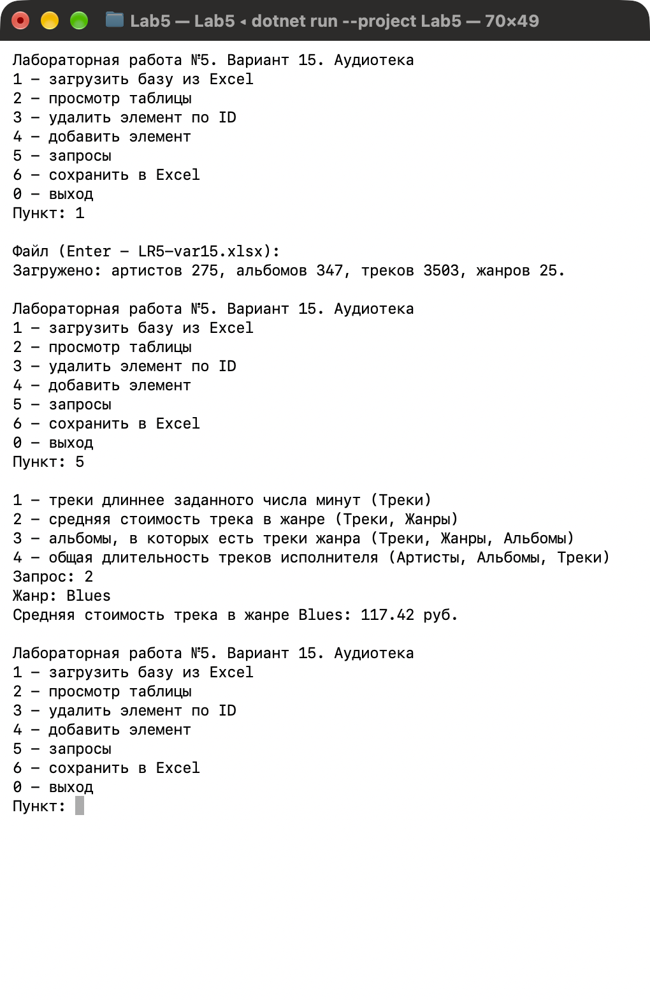
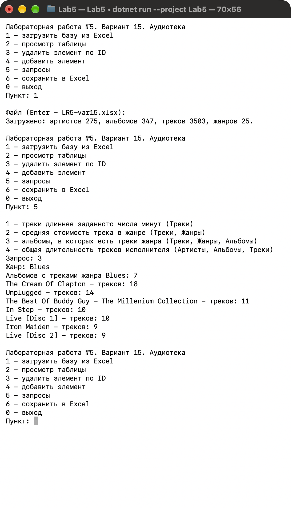
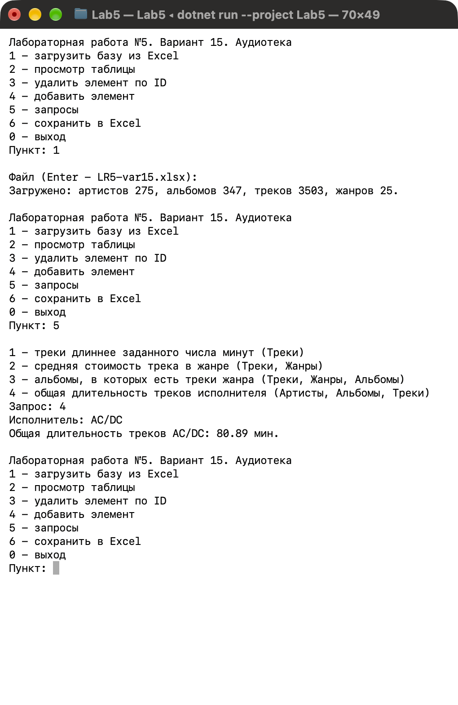
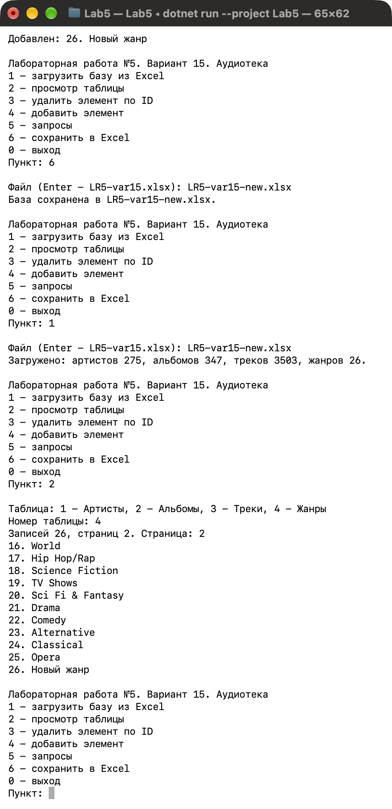

# Лабораторная работа №5. LINQ-запросы

Выполнил: Владимиров Савелий Олегович, ИТ-1  
Вариант: 15 (база данных «Аудиотека»)

## Запуск

```bash
dotnet run --project Lab5/Lab5.csproj
```

Программа запускается из папки решения, рядом лежит база `LR5-var15.xlsx`. Для работы с Excel используется библиотека ClosedXML, она подключается через NuGet при сборке. Исходный файл `LR5-var15.xls` пересохранён в формат `.xlsx`, потому что ClosedXML работает с этим форматом.

## База данных

Четыре листа Excel, каждой таблице соответствует свой класс:

| Таблица | Класс | Поля |
| --- | --- | --- |
| Артисты | `Artist` | ID, имя |
| Альбомы | `Album` | ID, название, ID исполнителя |
| Треки | `Track` | ID, название, ID альбома, ID жанра, длительность (мс), размер (байт), стоимость (руб.) |
| Жанры | `Genre` | ID, название |

У каждого класса есть закрытые поля, конструктор, свойства только для чтения и `ToString()`. У трека `ToString()` переводит длительность в минуты и секунды, а размер в мегабайты.

## Решение

Вся работа с базой — методы класса `AudioLibrary`, меню и ввод — в `Program` и `ConsoleInput`. Выборки, поиск и подсчёты написаны LINQ-запросами (`from … join … where … group … orderby … select`).

1. **Чтение.** `Load` открывает книгу, для каждого листа берёт строки со второй (первая — заголовки) и запросом превращает их в объекты. Если нет листа, в ячейке не число или файл не `.xlsx`, выводится сообщение об ошибке, а уже загруженные данные не меняются.
2. **Просмотр.** Таблица выводится страницами по 15 записей, пользователь выбирает таблицу и номер страницы.
3. **Удаление по ID.** Запись ищется запросом по ключу. Если на неё ссылаются другие таблицы (у исполнителя есть альбомы, в альбоме или жанре есть треки), удаление запрещается, чтобы в базе не остались ссылки на несуществующие записи.
4. **Добавление.** ID новой записи — максимальный ID в таблице плюс 1. Для альбома и трека проверяется, что указанные исполнитель, альбом и жанр существуют; пустое название, нулевая длительность и размер не принимаются.
5. **Запросы** (см. ниже).
6. **Сохранение.** `Save` записывает все четыре листа с заголовками в выбранный файл, по умолчанию — в тот, из которого база загружена.

Неверный ввод в меню и при вводе чисел запрашивается повторно. Ошибки при работе с файлом и данными перехватываются в `Program` и выводятся сообщением, программа продолжает работу.

## Запросы

| № | Формулировка | Таблицы | Результат |
| --- | --- | --- | --- |
| 1 | Треки длиннее заданного числа минут, от самого длинного | Треки | перечень |
| 2 | Средняя стоимость трека в заданном жанре | Треки, Жанры | одно значение |
| 3 | Альбомы, в которых есть треки заданного жанра, и сколько таких треков в каждом | Треки, Жанры, Альбомы | перечень |
| 4 | Общая длительность всех треков исполнителя в минутах | Артисты, Альбомы, Треки | одно значение |

Названия жанра и исполнителя сравниваются без учёта регистра. Если жанра или исполнителя нет в базе, выводится сообщение.

Ответы проверены по исходному файлу: треков длиннее 20 минут — 212, средняя стоимость трека в жанре Blues — 117.42 руб., треки Blues есть в 7 альбомах, общая длительность треков AC/DC — 80.89 мин.

## Результаты

Скриншоты сделаны при запуске `dotnet run` в терминале.

Загрузка: пункт меню до загрузки, несуществующий файл, загрузка базы по умолчанию.



Просмотр первой страницы таблицы «Треки»:



Удаление: жанр с треками удалить нельзя, исполнителя с ID 999 нет, трек 3503 удалён.



Добавление исполнителя, его альбома и трека в этот альбом:



Запрос 1 — треки длиннее 48 минут:



Запрос 2 — средняя стоимость трека в жанре Blues:



Запрос 3 — альбомы с треками жанра Blues:



Запрос 4 — общая длительность треков AC/DC:



Сохранение: добавлен жанр, база сохранена в новый файл и загружена из него заново — жанров стало 26, новый жанр на месте.


